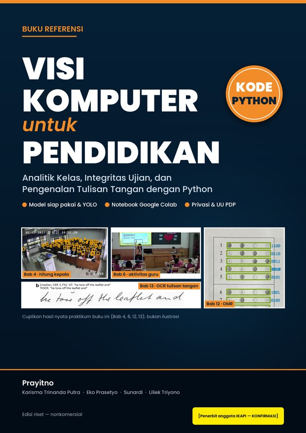
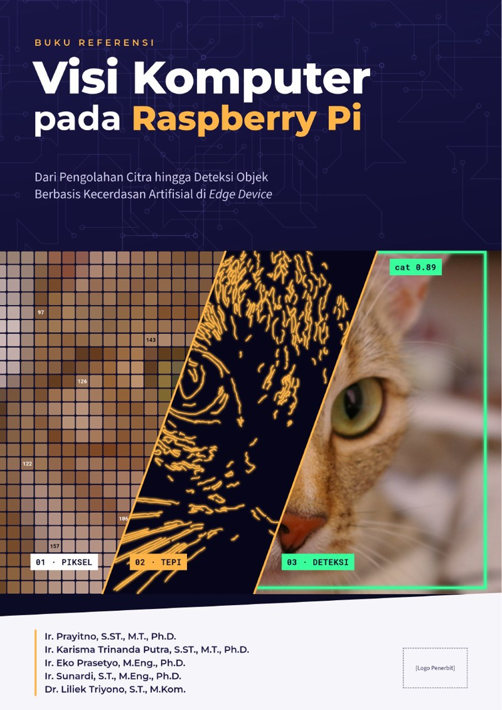

  

  <b>Associate Professor, Department of Electrical Engineering, Politeknik Negeri Semarang</b> 👁️ Computer Vision Researcher 
  <i>“Teknologi cerdas untuk lingkungan yang sehat dan pendidikan yang terbuka.”</i>

  
  
  
  
   
  
  
  

---

## 👋 About Me

I am **Assoc. Prof. Prayitno** (*Bos Pray*), **Associate Professor, Department of Electrical Engineering, Politeknik Negeri Semarang (Polines)**, Indonesia. My main research focus is **Computer Vision**: medical imaging, classroom analytics, robust object detection, and efficient vision transformers. I also serve as **Deputy Director for Program at SEAMOLEC** (SEAMEO Regional Open Learning Centre), and I am affiliated with the **Department of Electrical Engineering, Universitas Muhammadiyah Yogyakarta (UMY)** through the UMY Research Fellowship, working with Karisma Trinanda Putra.

Beyond vision, my work sits where **artificial intelligence meets the physical world and the classroom**: trustworthy AI on low-power edge devices, privacy-preserving learning across distributed sensors, and AI that makes education more open and equitable across Southeast Asia.

## 🔬 Research Focus

| Area | Themes |
|---|---|
| 👁️ **⭐ Computer Vision — main focus** | **Medical imaging · classroom analytics & education · object detection (YOLO, livestock in landfills) · vision transformers (MoNetViT)** |
| 🌐 **AIoT & Edge AI** | On-device inference, low-power sensing, open hardware |
| 🔒 **Federated & Continual Learning** | Privacy-preserving, drift-aware learning at the edge |
| 🌫️ **Environmental Intelligence** | Air-quality prediction, landfill monitoring, occupational safety (AI + IoT at landfill sites) |
| 🧠 **Multimodal LLMs** | Lightweight LLMs, automated essay scoring, retrieval |
| 🎓 **AI in Education** | Learning analytics, explainable AI, open & distance learning |

## 📦 Featured Research & Open Science

**Edge-CCIIL** — federated / edge continual learning for landfill-related air-quality prediction using ISPU DKI Jakarta data.

| Artifact | DOI | License |
|---|---|---|
| Software |  | MIT |
| Data & results |  | CC BY 4.0 |

**Selected public repositories**

- 🗑️ [`n1-trustworthy-waste-classification`](https://github.com/kang-prayit/n1-trustworthy-waste-classification) — trustworthy waste classification
- 🏥 [`visi-komputer-kesehatan`](https://github.com/kang-prayit/visi-komputer-kesehatan) — computer vision for healthcare
- 🏫 [`visi-komputer-pendidikan`](https://github.com/kang-prayit/visi-komputer-pendidikan) — computer vision for education
- 📘 [`buku_ai_pendidikan`](https://github.com/kang-prayit/buku_ai_pendidikan) — AI in education book materials
- 🗂️ [`scitrack-kanban`](https://github.com/kang-prayit/scitrack-kanban) — research task tracking

## 📖 Selected Books

<table>
  <tr>
    <td align="center" width="33%" valign="top"> <b>Visi Komputer untuk Kesehatan: Klasifikasi, Regresi, Deteksi, dan Segmentasi Citra Medis dengan Python</b> <a href="https://github.com/kang-prayit/visi-komputer-kesehatan">Code repo</a></td>
    <td align="center" width="33%" valign="top"> <b>Kecerdasan Buatan untuk Pendidikan: Prediksi, Analitik Pembelajaran, dan Penilaian Otomatis dengan Python</b> <a href="https://github.com/kang-prayit/buku_ai_pendidikan">Code repo</a></td>
    <td align="center" width="33%" valign="top"> <b>Visi Komputer untuk Pendidikan: Analitik Kelas, Integritas Ujian, dan Pengenalan Tulisan Tangan dengan Python</b> <a href="https://github.com/kang-prayit/visi-komputer-pendidikan">Code repo</a></td>
  </tr>
  <tr>
    <td align="center" width="33%" valign="top"> <b>Visi Komputer untuk Lingkungan dan Pengelolaan Sampah: Klasifikasi Sampah, Deteksi Objek, dan Pemantauan TPA dengan Python</b> <a href="https://github.com/kang-prayit/visi-komputer-lingkungan">Code repo</a></td>
    <td align="center" width="33%" valign="top"> <b>Kredensial Mikro Terverifikasi Blockchain: Arsitektur Tepercaya Terintegrasi Analitik Pembelajaran untuk Pendidikan di Asia Tenggara (Monograf)</b> <a href="https://github.com/kang-prayit/monograf-kredensial-blockchain">Code repo</a></td>
    <td align="center" width="33%" valign="top"> <b>Visi Komputer pada Raspberry Pi: Dari Pengolahan Citra hingga Deteksi Objek Berbasis Kecerdasan Artifisial di Edge Device</b> <i>Code repo coming soon</i></td>
  </tr>
</table>

📌 Forthcoming reference books (ISBN in process); covers are pre-publication drafts.

## 📚 Selected Publications

- **MoNetViT: an efficient fusion of CNN and transformer technologies for visual navigation assistance with multi query attention** — *Frontiers in Computer Science*, 2025. [doi:10.3389/fcomp.2025.1510252](https://doi.org/10.3389/fcomp.2025.1510252)
- **YOLO-CE for Accurate Livestock Detection in Challenging Landfill Environments** — *International Journal of Intelligent Engineering and Systems*, 2025. [doi:10.22266/ijies2025.0531.51](https://doi.org/10.22266/ijies2025.0531.51)
- **Optimizing Automated Essay Scoring with Lightweight Large Language Models and Validated Rubrics** — *Jurnal RESTI*, 2026. [doi:10.29207/resti.v10i2.7012](https://doi.org/10.29207/resti.v10i2.7012)
- **Week-Wise Student Performance Early Prediction in Virtual Learning Environment Using a Deep Explainable Artificial Intelligence** — *Applied Sciences*, 2022. [doi:10.3390/app12041885](https://doi.org/10.3390/app12041885)
- **A Systematic Review of Federated Learning in the Healthcare Area: From the Perspective of Data Properties and Applications** — *Applied Sciences*, 2021. [doi:10.3390/app112311191](https://doi.org/10.3390/app112311191)
- **Federated Compressed Learning Edge Computing Framework with Ensuring Data Privacy for PM2.5 Prediction in Smart City Sensing Applications** — *Sensors*, 2021. [doi:10.3390/s21134586](https://doi.org/10.3390/s21134586)

➡️ Full list on [ORCID](https://orcid.org/0000-0002-4794-2957).

## 🛠️ Tech Stack

  
  
  
  
  
  
  
  
  
  
  
  
  

---

## 🤝 Let's Collaborate

I welcome partners who want to turn AI research into real-world impact. Let's talk if you are interested in:

- 🔬 **Research collaboration** — computer vision, AIoT, edge AI, federated/continual learning, environmental monitoring
- 🎓 **Student supervision & exchange** — undergraduate, master's, and doctoral projects, internships
- 💰 **Joint grants & proposals** — national, regional (SEAMEO), and international funding schemes
- 🏫 **AI-in-education partnerships** — open learning, teacher capacity building, learning analytics

  
  
  
  

<i>Mari berkolaborasi — membangun AI yang bermanfaat untuk Indonesia dan Asia Tenggara.</i>

